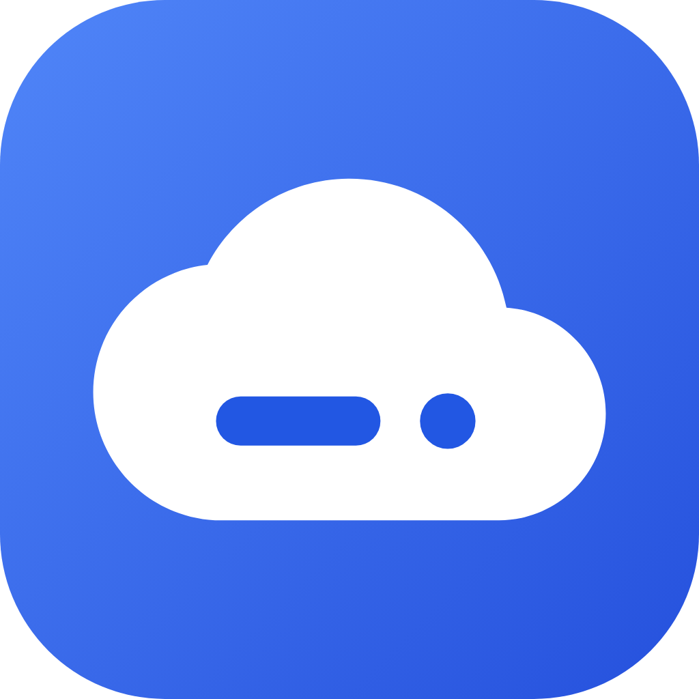
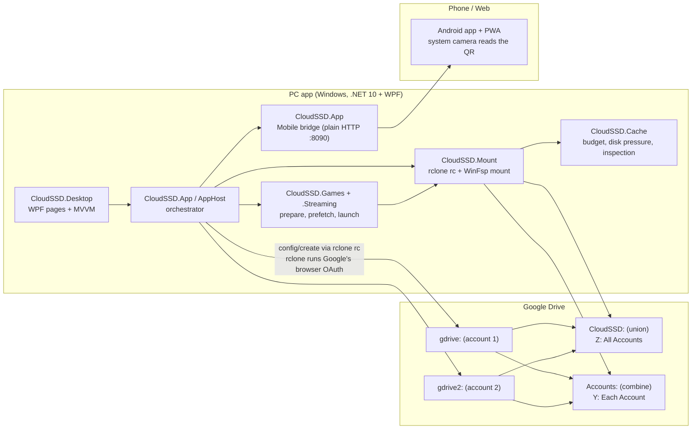
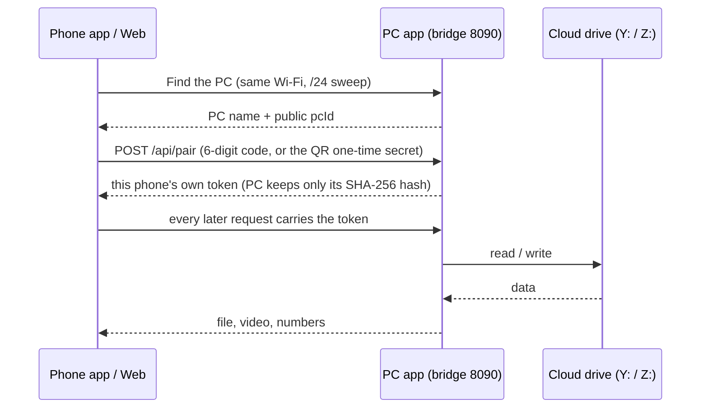
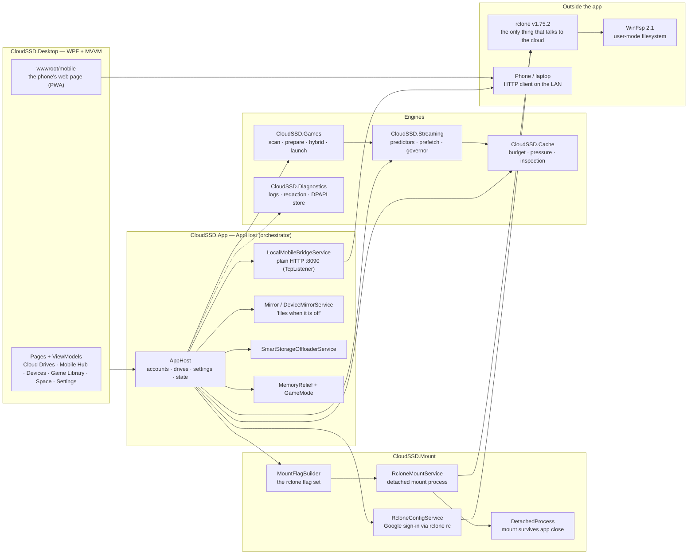

<div align="center">



# Cloud Drive (Cloud-SSD)

**Turn your Google Drive into a real drive on your PC — and use it from your phone too.**

Keep big games and files in the cloud, keep your SSD free, and open everything from `Z:` as if it were stored on the PC.

[](#setup)
[](#phone)
[](#architecture)
[](#how)
[](#download)
[](#download)
[](./LICENSE)

<br/>

<a href="https://github.com/allproject121/Cloud-Drive/raw/main/Cloud-SSD/Cloud-SSD/Cloud-SSD/releases/Cloud-SSD-0.9.0-win-x64.zip">

</a>
&nbsp;&nbsp;
<a href="https://github.com/allproject121/Cloud-Drive/raw/main/Cloud-SSD/Cloud-SSD/Cloud-SSD/releases/Cloud-SSD-Mobile-0.12.0.apk">

</a>

<br/><br/>

[What it does](#what) • [⚙️ How it works](#how) • [Features](#features) • [CLI Terminal](#cli) • [Phone & Web](#phone) • [Screenshots](#screenshots) • [Repository Standards](#standards) • [Download](#download) • [Setup](#setup) • [Architecture](#architecture) • [Folder map](#structure) • [Docs](#docs) • [Send feedback](#feedback)

</div>

> 📖 **How it works — real code, real numbers:** every flow is documented with its exact `file:line` anchor, the real HTTP route or rclone command, and measured timings in **[`docs/HOW-IT-WORKS.md`](./docs/HOW-IT-WORKS.md)**.  
> 👉 **[Jump to the step-by-step flows](#how)**

---

<a id="what"></a>

## 🧐 What it does

Cloud Drive connects your **Google Drive account** to Windows as a **real drive letter** (`Y:` / `Z:`). File Explorer, games and every other app see it as a normal hard disk.

| Your problem | What Cloud Drive does |
|---|---|
| The PC's SSD is full | Files stay in the cloud; only the part you need right now comes to the PC |
| A 100 GB game must be downloaded completely | The game downloads only the pieces it actually reads |
| One Google account does not have enough space | Several accounts are joined into **one big drive** |
| The phone is low on storage | Send photos and files from the phone straight to the cloud drive |
| You want your PC's files on the phone | Open the cloud drive in the phone app or a browser and play videos directly |

> **This is not cloud gaming.** The game runs on your own PC's CPU and GPU. Cloud Drive connects *storage* to the cloud — it does not stream video.

---

<a id="how"></a>

## ⚙️ How it works

Yeh section **sirf wahi batata hai jo code me hai**. Har claim ke saath exact `file:line` anchor hai, asli HTTP route ya rclone command hai, aur measured number hai jahan number maani ka claim hai.

Poora detailed walkthrough — 12 flows, code anchors, real commands, examples — alag file me hai: **[`docs/HOW-IT-WORKS.md`](./docs/HOW-IT-WORKS.md)**.



### Flow 1 — App khola, ek email login kiya

**Ek line me:** Cloud-SSD khud OAuth nahi karta. Wo ek private `rclone rcd` daemon loopback par chalata hai, uske rc API se Google Drive remote banata hai, aur **rclone** browser me Google ka official consent page kholta hai. App ko password kabhi nahi milta.

```
[Connect Cloud Account]  →  [rclone rcd --rc-addr 127.0.0.1:<random>]
   src/CloudSSD.Desktop/ViewModels/CloudDrivesViewModel.cs:128-135
   src/CloudSSD.Mount/RcloneConfigService.cs:314, 541-548
        ↓
[HTTP POST config/create {name:"gdrive", type:"drive", parameters:{scope:"drive"}}]
   src/CloudSSD.Mount/RcloneConfigService.cs:332-338
        ↓
[AnswerQuestionsAsync → "config_is_local" = "true"]   ← rclone ko bolo: "tum browser flow khud karo"
   src/CloudSSD.Mount/RcloneConfigService.cs:508-537
        ↓
[rclone browser kholta hai → Google consent → rclone ka apna redirect listener token leta hai]
        ↓
[operations/about → quota verify]   src/CloudSSD.Mount/RcloneConfigService.cs:347-350
```

- **Remote ka naam email nahi hota** — plain counter: `gdrive`, `gdrive2`, `gdrive3` (`src/CloudSSD.Desktop/Views/ConnectDriveWindow.xaml.cs:34-39`).
- **Token kahan gaya** — `%LOCALAPPDATA%\Cloud-SSD\rclone.conf` me, rclone ke apne encryption ke andar. App sirf `RCLONE_CONFIG` env var set karta hai.
- **Email kaise mila** — sign-in ke baad app rclone ke config se access token uthata hai aur Google se khud puchta hai (`RcloneConfigService.cs:458-470`), phir `settings.json` me cache karta hai.
- **Aadha account nahi chhoda jaata** — cancel/timeout par remote delete (`RcloneConfigService.cs:352-359`).
- **PKCE nahi hai, `rclone config authorize` nahi hai** — poora OAuth flow rclone ka apna hai; app sirf uska driver hai.

### Flow 2 — Doosra email login kiya

Naya remote banta hai → dono generated drives dobara likhi jaati hain → **Z: aur Y: dono disconnect hokar wapas mount hote hain**, kyunki running mount ko nayi account list nahi milti (`src/CloudSSD.App/AppHost.cs:366-382`).

Jo config likhi jaati hai:

```
[CloudSSD]                     ← Z: All Accounts
type = union
upstreams = gdrive: gdrive2:
action_policy = epmfs          # edit/delete usi account me jata hai jahan file hai
create_policy = mfs            # nayi file sabse khali account me
search_policy = ff             # read me pehla mila wala

[Accounts]                     ← Y: Each Account
type = combine
upstreams = user@gmail.com=gdrive: other@gmail.com=gdrive2:
```

- **Same Gmail dobara?** Naya remote delete ho jaata hai aur warning aata hai — asli doosra account add karne ke liye Google page par **"Use another account"** dabana padta hai (`src/CloudSSD.App/AppHost.cs:311-319`).
- **Koi file move nahi hoti.** File wahi rehti hai jis account me thi. Sirf nayi writes sabse khali account me jaati hain.
- **Ek account ho to** `CloudSSD` ek **alias** ban jata hai, union nahi — rclone ek-ka-upstream union accept nahi karta (`src/CloudSSD.App/AppHost.cs:388-396`).

### Flow 3 — Drive letters aur asli rclone command

| Mount id | Naam | Remote | Letter | Backend |
|---|---|---|---|---|
| `cloudssd` | All Accounts | `CloudSSD:` | **Z:** | union (ek account par alias) |
| `accounts` | Each Account | `Accounts:` | **Y:** | combine |

**Z/Y preference hai, guarantee nahi** — agar letter busy hai to auto-allocate hota hai, preference order `GXYZWV…` (`src/CloudSSD.Mount/MountPlanning.cs:24-34`).

Poora command `src/CloudSSD.Mount/MountPlanning.cs:58-185` se banta hai. Sabse important flags:

```
rclone mount CloudSSD: Z:
  --vfs-cache-mode full          --vfs-read-chunk-size 4Mi
  --vfs-read-chunk-size-limit 4Mi   --vfs-cache-max-size 20Gi
  --vfs-cache-min-free-space 8Gi     --vfs-cache-max-age 720h
  --buffer-size 0               --vfs-read-ahead 0
  --dir-cache-time 72h          --attr-timeout 24h
  --vfs-write-back 5s           --vfs-refresh
  --links                       --no-checksum
  --file-perms 0777 --dir-perms 0777
  --tpslimit 10                 --rc --rc-addr 127.0.0.1:<port>
```

- **`--vfs-disk-space-total-size` jaan-boojh kar nahi diya** — ek fixed "15T" se har drive Explorer me 15 TB dikhata tha. Bina iske rclone asli quota batata hai (`MountPlanning.cs:107-108`).
- **`--buffer-size 0` aur `--vfs-read-ahead 0`** — speculative download se game ka cold launch ~3× slow ho jaata tha (`src/CloudSSD.Core/Settings.cs:85-90`).
- **Secrets command line par nahi** — env me jaate hain: `RCLONE_CONFIG`, `RCLONE_CONFIG_PASS`, `RCLONE_RC_USER`, `RCLONE_RC_PASS` (`src/CloudSSD.Mount/MountService.cs:205-212`).
- **App band karne par mount zinda rehta hai** — rclone detached spawn hota hai, NUL stdio, koi pipe nahi (`src/CloudSSD.Mount/DetachedProcess.cs`).

### Flow 4 — File kaise padhi jaati hai (chunked read + cache)

Do cache modes hain (`src/CloudSSD.Core/Settings.cs:69-76`), UI toggle **"Fast browsing"**:

- **ON → `full`** = file local rakhna; dobara kholna instant.
- **OFF → `writes`** = kuch nahi rakhna; har read seedha cloud se.

`--vfs-read-chunk-size-limit` = chunk size (4 MiB) set kiya gaya hai, warna rclone har read par chunk double kar deta tha.

**Measured A/B** (same quota, alag mount, naya cache):

| Mount | 1 MB cold | 460 MB cold | 7 GB cold | WARM (dobara kholna) | Cache |
|---|---|---|---|---|---|
| `writes` | 22,387 ms | 4,706 ms | 4,036 ms | 3,279 / 5,307 / 5,027 ms | **0 MB** |
| `full` + 256 MiB limit | 4,596 ms | **38,383 ms** | 3,544 ms | 16 / 23 / 14 ms | 0.7 MB |
| **`full` + 4 MiB limit** | 13,038 ms | **4,328 ms** | 4,330 ms | **14 / 10 / 11 ms** | 0.8 MB |

Nayi install par asli Z: par: Jarvis.zip 25,421 ms → **116 ms**; 460 MB zip list **19,958 ms** (17,979 entries) + 246 MB exe extract **180,515 ms** (bytes exact); **7 GB zip list 2,955 ms**, 25,183 entries.

- **Archive warmer** (`.zip/.7z/.rar`): 8 MiB tak poora file, usse bada → aakhri 1 MiB (zip ka file list) + pehle 128 KiB, per directory max 40 (`src/CloudSSD.App/ArchiveWarmer.cs:63-66`). **Sirf `full` mode me kaam karta hai** — `writes` me rclone reads cache karta hi nahi.
- **Predictive prefetch** — pehla-order Markov chain + sequential detector + startup predictor. **"ML" nahi** — code khud kehta hai *"Deterministic and fully explainable"* (`src/CloudSSD.Streaming/Predictions.cs:26-31`).
- **Cache budget** 20 GiB default, 8 GiB reserve (`src/CloudSSD.Core/Settings.cs:64,67`); over-run margin 10% (`src/CloudSSD.Cache/DiskSafety.cs:28`). Eviction khud **rclone** karta hai — Cloud-SSD ka apna LRU evictor nahi hai.

### Flow 5 — QR code kaise aata hai

**Ek line me:** QR **PC** banata hai (khud ka pure-C# encoder, koi library nahi), usme hota hai `http://<pc-ip>:8090/?pair=<32-hex>`, aur woh secret **ek hi baar, 10 minute, sirf ghar ke LAN par** chalta hai. Phone ka **system camera** use karta hai — Cloud-SSD app me koi QR scanner nahi hai.

```
http://192.168.1.5:8090/?pair=9f3ac7b14e8d2065f1a4c8b93d7e0512
```

- Generator: `src/CloudSSD.Desktop/QrCodeGenerator.cs` — ISO/IEC 18004, versions 1–6, EC level L, mask 0, WPF `BitmapSource`. **Koi QR API call nahi.**
- Banaya kahan: `src/CloudSSD.Desktop/ViewModels/MobileHubViewModel.cs:177-196`.
- Secret ke rules: `src/CloudSSD.App/LocalMobileBridgeService.Security.cs:202-244` — **one-time, 10 min, LAN-only**, use hote hi rotate.
- QR me kaunsa IP: `LocalMobileBridgeService.Security.cs:288-302` — Wi-Fi + 192.168.x sabse upar; **Tailscale (−100) aur link-local (−50) kabhi nahi**.
- **6-digit code** bhi hai (`LocalMobileBridgeService.cs:56-67`) — single-use; 5 galat guess par 60-second lockout. Iska koi clock expiry nahi hai.
- Phone QR kaise kholta hai: `src/CloudSSD.Desktop/wwwroot/mobile/app.js:4779-4795` → `applyPairLink` → `POST /api/pair?pair=…` → `app.js:1264-1279`.

### Flow 6 — Phone se file transfer kiya

| Raasta | Route | Details |
|---|---|---|
| Phone → cloud drive | `POST /api/fs/write` | `.part` me likhta hai, pura hone par rename — cloud ko kabhi half-written file nahi dikhti (`LocalMobileBridgeService.Files.cs:461-556`) |
| Phone → PC | `POST /api/upload` | resumable staging (`%LOCALAPPDATA%\Cloud-SSD\incoming`), `offset`+`total` (`LocalMobileBridgeService.Upload.cs:11-16`) |
| PC → phone | `/api/download`, `/api/stream` | range-based; signed link bina token, 1 h (download) / 12 h (stream) (`LocalMobileBridgeService.Security.cs:421-447`) |
| PC → phone (offer) | `/api/share/*` | PC offer karta hai, phone accept/decline, phir resume download (`LocalMobileBridgeService.Share.cs`) |

Space pehle check hota hai — free space se 10 GB reserve nikaal ke (`Files.cs:510-514`). Transfer progress dono taraf ek hi shape me dikhti hai (`src/CloudSSD.App/TransferTasks.cs:10-14`).

### Flow 7 — Phone ↔ Laptop

Seedha nahi — beech me wahi PC hota hai.

- **Laptop → PC → Phone (relay)**: `/api/peer/fs/{roots,list,tree,read}?device=<phone>` — phone ko waise hi pucha jaata hai jaise PC puchta hai, aur phone utna hi jawab deta hai jitna allow karta hai (`src/CloudSSD.App/LocalMobileBridgeService.Peer.cs:173-176`).
- **Bina port khole**: phone ek long request khuli rakhta hai (`/api/peer/inbox`, 25 s), PC usme sawal deta hai, phone `/api/peer/result` par jawab deta hai (`src/CloudSSD.App/PeerBroker.cs:26-36`).
- **Laptop → doosra PC**: "Other PCs" page par 6-digit code se pair; har address par **proof** maanga jaata hai (`src/CloudSSD.App/Remote/RemotePcClient.cs:129-133`), download resume ke saath hota hai.
- File access **shared roots** tak scoped hai — cloud drives + upload folders (+ on request PC ke apne disks). Refusal codes: **400** galat path, **404** drive connected nahi, **403 `not-shared`**.

### Flow 8 — "PC off ho to bhi files"

Har device-pair ke liye **dono taraf** se "haan" chahiye, warna ye off hi rehta hai (`src/CloudSSD.App/LocalMobileBridgeService.WhenOff.cs:14-20`). Mirror engine (`src/CloudSSD.App/Mirror/DeviceMirrorService.cs:18-24`) disk dekhta hai, naya/badla hua copy karta hai (chhote files pehle), delete kiye gaye files trash folder me, aur state likhta hai. Game chalne par, battery par, ya user ke pause karne par ruk jaata hai.

Device ko sirf **Google key** milta hai — sign-in nahi — taaki koi account access ghar ke LAN par na chale (`WhenOff.cs:134-135`).

### Flow 9 — Gaming: prepare aur launch

"Optimize & Prepare" ke **8 steps**: folder scan → cache capacity → network measure → profile load → compatibility → essential files → prefetch → validate (`src/CloudSSD.Games/GamePreparer.cs:48-55`).

- Network measurement mount **bypass** karti hai (`rclone cat --offset --count`), to cache pollute nahi hota.
- Profile nahi hai to jhooth nahi bolta — *"No launch profile yet — startup data unknown."*
- Validate PE header padhta hai aur rclone ke range index se coverage check karta hai; `ReadyToLaunch` tabhi jab coverage ≥ 0.95.
- Launch Windows **Job Object** me chalta hai, kill-on-close **nahi** — Cloud-SSD band karne par game nahi marta (`src/CloudSSD.Games/GameLauncher.cs:11`).
- **Hybrid mode**: ≤ 2 MiB ya essential extension (≤ 256 MiB) files copy, baaki symlink (`src/CloudSSD.Games/ExecutionModes.cs:29-42`). Iske liye **Windows Developer Mode ya admin** chahiye — nahi hai to mode apne aap Cloud Direct ho jaata hai (`src/CloudSSD.Diagnostics/Dependencies.cs:49-50`).
- **Honest**: prepare launch ko gate nahi karta — sirf warn karta hai.

### Flow 10 — Phone par game stream (video)

`src/CloudSSD.GameStream/` asli H.264 video + audio + touch injection karta hai: DXGI capture → Media Foundation hardware H.264 → WASAPI loopback audio → HTTP `101 Switching Protocols` + binary framing. Sirf **home LAN**, aur paired device key chahiye (purana shared token refuse hota hai). Ye cloud game library nahi — **emulator ka game area** stream karta hai.

### Flow 11 — Memory relief, Space, offloader

- **Memory relief** — `kernel32.dll!K32EmptyWorkingSet` background processes ki working set trim karta hai. Kuch kill nahi hota. **"3-5 GB" koi claim nahi hai** — code me koi byte target nahi; freed amount har run me measure hokar dikhaya jaata hai (`src/CloudSSD.App/MemoryRelief.cs:91-95`, `src/CloudSSD.App/MemoryHealth.cs:200-224`).
- **Space page** — har folder ka live size map, `FileSystemWatcher` se sirf badle folders dobara measure (`src/CloudSSD.App/SpaceIndex.cs`). Windows, Program Files, AppData aur saare cloud drives kabhi delete ke liye offer nahi hote.
- **Smart offloader** — disk kam hone par phone se aayi files seedha cloud me chali jaati hain, drive letter ke through nahi (warna cache me khaali jagah nahi bachti) (`src/CloudSSD.App/SmartStorageOffloaderService.cs:201-208`). Game chalte time auto offload bilkul nahi hota; sirf ≥ 100 MiB aur ≥ 7 din purane Downloads files; adhoora download aur khuli hui file skip.

### Flow 12 — Security aur storage: kahan kya pada hai

| Cheez | File | Protection |
|---|---|---|
| Google refresh token + client secret | `%LOCALAPPDATA%\Cloud-SSD\rclone.conf` | rclone ka apna config encryption; password `rclone.conf.key` me |
| `rclone.conf.key` | aahi file | **Windows DPAPI** (`SecretStore`) |
| Phone pairing token + media signing key | `settings.json` | **Windows DPAPI** (`SecretProtector`) |
| Mount ka RC password | `mounts.state.json` | DPAPI (`MountService.cs:541`) |
| Apna Google OAuth client | `google-client.json` | **plaintext JSON** |

- **DPAPI scope `CurrentUser`** — doosre Windows user par copy karke koi faayda nahi (`src/CloudSSD.Core/SecretProtector.cs`).
- **`settings.json` me koi OAuth token nahi** — login sirf `rclone.conf` me hai.
- **Phone bridge plain HTTP hai** — koi TLS nahi (`src/` me `SslStream`/`Tls12`/`Tls13` koi use nahi hota). Security token + LAN/Tailscale rules par tiki hai. **"mTLS 1.3" jaisa koi claim nahi hai.**
- PC har phone ka **sirf SHA-256 hash** rakhta hai, token nahi (`LocalMobileBridgeService.Security.cs:43`); comparison constant-time.
- Token **har request** me chahiye — same Wi-Fi par hona kaafi nahi.
- **Permissions do layers me hain**: PC-wide switches (9) aur per-device grants (`browse, stream, upload, manage, hud, control, space, game, relay`).
- **Audit log** — per device per day JSON lines, 30 din (`src/CloudSSD.App/AccessLog.cs:8-15`).
- **Honest gap**: `/api/status` unauthenticated hai aur `pcName`, `version`, `port`, `pcId`, `features` bata deta hai. Drives/games/storage nahi dikhata — deliberately.

---
<a id="features"></a>

## ✨ Features

### 💻 PC app (Windows)

| Feature | What you get |
|---|---|
| **Two cloud drives** | **Each Account** (`Y:`) — one folder per Google account. **All Accounts** (`Z:`) — all accounts joined into one big drive |
| **Many accounts** | Connect as many Google accounts as you like; each one is listed with its Gmail address and free space |
| **Smart Cache** | A cache size limit, protected free space on the cache disk, and only the parts that were really read take up disk space (rclone's sparse cache files) |
| **Game Library** | 3 modes: **Cloud Direct** (run from the drive), **Hybrid** (exe/dll on the PC, big data from the cloud), **Full Local** (copy everything) |
| **Optimize & Prepare** | Downloads a game's startup data before you press Play |
| **PC Memory (RAM)** | Shows memory health; when less than 30% RAM is free it trims the working set of idle background apps on its own (how much was freed is measured and shown after each run) |
| **Storage auto mode** | When the PC runs low on space, files uploaded from the phone are moved to the cloud drive |
| **Mobile Hub** | A 6-digit pairing code and a one-time QR link for the phone, the list of connected phones, and switches for what a phone may do |
| **Diagnostics** | Status of everything the app needs, logs, and a "sanitized report" that contains no logins or tokens |
| **Languages** | English, Hindi, Hinglish |
| **`cpx` command** | Checks and mounting without a window: `cpx deps`, `cpx remotes`, `cpx mounts` |

### 🔒 Security

- Your Google password is never typed into the app — the sign-in happens on Google's own page, driven by rclone.
- The saved login is stored encrypted on the PC: rclone's own config encryption, and its password protected by **Windows DPAPI**.
- The phone bridge binds to all interfaces but **refuses** anything that is neither the home network nor Tailscale, and every request must carry the device token.
- The PC keeps only the **SHA-256 hash** of each phone's token, never the token itself.
- The phone bridge is **plain HTTP** — there is no TLS. Confidentiality rests on the 128-bit token plus who can reach the port.
- The app runs without administrator rights and does not change Windows security settings.

---

<a id="phone"></a>

## 📱 Phone app and 🌐 Web

There are two ways to use it on a phone, and both show the same thing:

| | **Android app** | **Web (browser)** |
|---|---|---|
| How to open it | Install the APK | Open `http://<PC-IP>:8090` in a browser |
| Where it runs | Android 7.0+ | Any phone, tablet or second laptop on the same Wi-Fi |
| Home-screen icon | Yes | Yes ("Install on Home Screen" — PWA) |
| Automatic camera backup | Yes | No |
| Cloud drive inside the phone's Files app | Yes | No |

### What you can do from the phone

| Section | What it does |
|---|---|
| **Cloud SSD** | Browse the PC's cloud drive, open / download files, create folders, rename / move / delete |
| **Send to PC** | Send photos or any file from the phone to the cloud drive; a transfer list shows progress |
| **Camera backup** | New photos and videos go to `Phone Backup/<phone>/Camera/<year-month>` automatically |
| **Media** | Videos and audio play directly, without downloading the whole file first |
| **Gaming companion** | Live numbers from the PC: CPU, GPU, RAM, cloud read MB/s, cache hits, Wi-Fi latency; game save backups |
| **PC media remote** | Mute, Previous, Play / Pause, Next |
| **Laptop Space Saver** | Free up space on the PC from the phone |
| **This phone** | The phone's RAM and storage, and the phone's files by category |
| **Languages** | English, Hindi, Hinglish |

### How the phone connects to the PC



Two ways in, and both only work on the home network:

- **6-digit code** - typed in the phone app. Single use; 5 wrong guesses lock code pairing for 60 s.
- **QR code** - the PC shows `http://<pc-ip>:8090/?pair=<32-hex>`. The **phone's system camera** opens it (Cloud-SSD has no QR scanner of its own). The secret works **once**, for **10 minutes**, home network only.

After pairing, the phone has its own 128-bit token; the PC stores only the token's SHA-256 hash.

> **Please note:** today the phone works **through the PC**. The PC app must be running and the phone must be on the same Wi-Fi. Reaching the cloud straight from the phone, without the PC, is the next piece of work and is not built yet.

---

<a id="cli"></a>

## 💻 Interactive Terminal CLI (`cloudssd` & `cpx`)

Cloud-SSD has a terminal shell laid out like **Claude Code** and **Codex**: a welcome box with a gradient
**CLOUD-SSD** logo and live vitals, a framed input line, a command list that opens when you type `/`, answers shown as
`● Heading` with `└` under it, a spinner while a command works, earlier commands on `↑` `↓` (kept between runs), and a
**Yes / No question** before anything that closes or deletes. You can also **just say it in English or Hinglish**
(`z drive kholo`, `phone dikhao`). It works in Windows Terminal, PowerShell and the classic `cmd.exe` window (colour codes
are switched on by the program itself).

### 🚀 Open the shell
```cmd
cloudssd
```
*(or the short name `cpx`)*

```text
╭────────────────────────────────────────────────────────────────────────────╮
│ >_ Cloud-SSD  v0.9.0                                                       │
│                                                                            │
│ Your Google Drive as a real drive letter on this PC.                       │
│                                                                            │
│ app     ● running · PID 13768                                              │
│ drives  Y:  Z:                                                             │
│ phone   My phone · seen 2 min ago                                        │
│ data    C:\Users\<you>\AppData\Local\Cloud-SSD                             │
╰────────────────────────────────────────────────────────────────────────────╯

 Tips for getting started:
 1. Type / to see every command, ↑ ↓ to pick, Enter to run
 2. /status shows everything at once · /open opens your drive
 3. Plain words work too: status, open y, phone

╭──────────────────────────────────────────────────────────────────────────────────────────────────╮
│ > /st                                                                                            │
╰──────────────────────────────────────────────────────────────────────────────────────────────────╯
› /status                  Everything at a glance: app, drives, cache, accounts, phone
  /start                   Start the Cloud-SSD app
  /stop                    Close the Cloud-SSD app
  ↑↓ choose · tab fill in · enter run · esc close
```

After Enter:

```text
> /status

● Status
  └  PC app     ● running · PID 13768 · 220.6 MiB memory
     Drives     Y:  Each Account     14.93 TiB free of 15.00 TiB
                Z:  All Accounts     14.93 TiB free of 15.00 TiB
     Cache      60.00 GiB budget · C: has 136.39 GiB free
     Accounts   you@gmail.com  (gdrive)
     Phone      My phone · seen 2 min ago
```

### 🗣️ Or just say it (English or Hinglish)

No need to remember the commands. The shell shows what it understood (`→ /cache`) and runs it:

| You type | It runs |
|---|---|
| `z drive kholo` · `y drive open karo` | `/open Z:` · `/open Y:` |
| `drive kholo` | asks *Which drive should open?* (Y: / Z:) |
| `phone dikhao` · `फोन दिखाओ` | `/phone` |
| `kitni jagah bachi hai` | `/cache` |
| `google account dikhao` | `/accounts` |
| `kya haal hai` | `/status` |
| `kya dikkat hai` · `drive slow hai` | `/problem` |
| `speed dikhao` | `/live` |
| `google key lagao` | `/key` |
| `photo.jpg dhundho` · `z drive mein report dhundho` | `/find photo.jpg` · `/find report in Z:` |
| `photo.jpg phone ko bhejo` | `/send photo.jpg` |
| `z drive jodo` · `z drive hatao` | `/connect Z:` · `/disconnect Z:` (disconnect asks Yes / No) |
| `app band karo` · `safai karo` | `/stop` · `/clean` (after a Yes / No question) |

It is simple word matching, not AI, so it is instant and predictable. From the command line
(`cloudssd drive kholo`) it works the same, except that sentences never close or delete there: type `cloudssd stop`.

### ✅ Yes / No before closing or deleting

```text
╭──────────────────────────────────────────────────────────────────╮
│ Close the Cloud-SSD app?                                         │
│ The drives keep working. The phone cannot reach this PC until /start. │
│                                                                  │
│   1. Yes, close it                                               │
│ › 2. No, keep it running                                         │
╰──────────────────────────────────────────────────────────────────╯
  ↑↓ or 1-2 choose · enter ok · esc cancel
```
**No** is chosen to start with, so an Enter pressed by mistake changes nothing. Asked before `/stop` (when the app runs)
and `/clean`.

### 🔌 How the terminal talks to the running app

`/connect`, `/disconnect` and `/send` are done by the PC app (it owns the drives and the phone link). The terminal asks it
over `127.0.0.1` with a **terminal key**: a random key the app writes at every start into `cli.key` in its data folder,
protected with Windows DPAPI so only your Windows user can read it. The key is accepted from this PC only, and opens
nothing but the drive list, connect / disconnect and send (everything else answers 403). `/live` reads each drive's own
rclone statistics the same way the app's speed graph does; it changes nothing.

### ⌨️ Keys

| Key | What it does |
|---|---|
| `/` | Opens the command list; keep typing to filter it (`/st` → status, start, stop) |
| `↑` `↓` | Move in the list, or bring back earlier commands |
| `Tab` | Fill in the chosen command (and a space when it needs something after it) |
| `Enter` | Run it |
| `Esc` | Close the list, or empty the line. While a command runs: stop waiting. In a question: cancel |
| `1` `2` | Answer a question by its number |
| `Ctrl+L` | Clean the screen |
| `Ctrl+C` | Empty the line; twice on an empty line: leave |

A mistyped word gets a hint: `stauts` → *Did you mean /status?*

### 📋 Commands

| Command | Also | What it shows / does |
|---|---|---|
| `/status` | `s` | PC app (running, PID, memory), cloud drives with free space, cache budget, accounts, phone last seen |
| `/open [letter]` | `o` | Opens a drive in File Explorer. After `/open ` the list shows your drives; with no letter it asks which one |
| `/problem` | `problems` | What is wrong right now and what to do, in simple Hinglish: reads the app log (never prints a log line) and checks app, drives, shared Google key, free space |
| `/live` | `watch`, `speed` | Live screen, every second: download speed, busy transfers, uploads and cache of each drive. Esc stops |
| `/key` | | Your own Google key, step by step (the real fix for slow drives): which accounts still use the shared key, the 5 steps, opens the browser, waits for the key file, then points to the app button |
| `/drives` | `mounts`, `m` | Every drive set up in Cloud-SSD: letter, on/off, remote, id |
| `/connect [letter]` | | Connects a cloud drive again (needs the running app) |
| `/disconnect [letter]` | `eject` | Disconnects a cloud drive; asks Yes / No first (needs the running app) |
| `/accounts` | `remotes`, `r` | Connected Google accounts, and the joined views behind `Y:` / `Z:` |
| `/phone` | `devices`, `p` | Paired phones: last seen, address, "files when off" yes/no, data moved |
| `/ls <folder>` | `dir` | What is inside a folder: `/ls z`, `/ls Z:Games`, `/ls downloads` |
| `/find <name> [in <folder>]` | `search` | Finds files by name (`photo`, `*.zip`) on the "All Accounts" drive; first 50, Esc stops |
| `/copy <from> <to>` | `cp` | Copies a file or folder with a progress bar. Never overwrites; a stopped copy leaves no half file |
| `/send <file> [to <phone>]` | | Offers a file or folder on this PC to your phone (accept it in the phone app; needs the running app) |
| `/cache` | `c` | Cache folder, budget, space kept free for Windows, disk free space with a bar |
| `/clean` | | Deletes temporary files older than 7 days (never your own files; asks Yes / No first) |
| `/mirror` | `sync` | Cloud copy of this PC: paused or copying, account, which folders |
| `/start` / `/stop` | | Starts / closes the Cloud-SSD app (closing asks Yes / No first) |
| `/deps` | `doctor` | Checks WinFsp, rclone and free space, with the fix for anything missing |
| `/scan <folder>` | | Will a game folder run from the cloud |
| `/pe <file.exe>` | | What a program needs to start (DLLs) |
| `/help` | `?` | All commands and keys |
| `/exit` | `quit`, `q` | Leave the shell |

### ⚡ One command, then back (scripts)
```cmd
cloudssd status
cloudssd phone
cloudssd open Z:
cloudssd --help
```
When the output goes into a pipe or a file (`cloudssd status > status.txt`) it is plain ASCII text without colours.
`NO_COLOR=1` switches colours off but keeps the frame. Piped input works too: `echo status | cloudssd`.

---

<a id="screenshots"></a>

## 📸 Screenshots

Clean, high-resolution screenshots of both the mobile companion and desktop workstation edition. All captures show actual application screens with zero media/video playback.

### 📱 Part 1: Android Phone App

The Android companion connects securely to your PC over Wi-Fi, allowing you to browse your cloud files, transfer data, and access mirrored copies even when the PC is off.

<div align="center">

| 1. Home Dashboard | 2. Connect & Pair | 3. Cloud SSD Drive |
|:---:|:---:|:---:|
|  |  |  |
| Native card view showing PC drives & quick transfers | 6-digit PIN pairing with desktop app | Browse `Z:` All Accounts & `Y:` Each Account |

<br/>

| 4. Pin Offline Access | 5. Offline Cloud Mirror ("When PC Off") | 6. App Icon Picker |
|:---:|:---:|:---:|
|  |  |  |
| Pin files & folders offline to open without PC or internet | Access mirrored PC copies in cloud when PC is powered off | Customize mobile app icon (Ocean, Kit, Paper, Sunset) |

<br/>

| 7. Gaming Performance & Remote HUD | 8. Offline copies on the phone | 9. App Settings & Languages |
|:---:|:---:|:---:|
|  |  |  |
| Real-time PC stats: FPS, GPU/CPU temps, remote game launch | "Keep offline" copies on the phone: the chosen PC files live in the app's own storage, so they open while the PC is away | English, Hindi & Hinglish localization + paired PC list |

<br/>

| 10. Remote Access Allowed | 11. Permission & Security Editor | 12. Remote Pin Offline Kept |
|:---:|:---:|:---:|
|  |  |  |
| Verified remote connection status from trusted phone | Granular per-device file and drive permission controls | Persistent local pinning indicator on cloud items |

<br/>

| 13. Glow Theme Cards | 14. Kit Theme Cards | 15. Paper Theme Cards |
|:---:|:---:|:---:|
|  |  |  |
| Vibrant neon glowing border and elevation styling | Clean tactile kit styling with subtle borders | Minimalist paper document card presentation |

</div>

---

### 💻 Part 2: Laptop & Desktop PC App

The Windows desktop app manages your Google Drive mount points, RAM caching, smart offloading, and phone connectivity with zero lag.

<div align="center">

| 1. Dashboard Overview | 2. Cloud Drives Manager |
|:---:|:---:|
|  |  |
| Real-time drive health, active accounts, and transfer speeds | Multi-account Google Drive mounting and sync settings |

<br/>

| 3. Devices & Virtual Backup | 4. Mobile Hub & Pairing |
|:---:|:---:|
|  |  |
| Paired phones, remote access rules, and automated PC mirror | QR pairing code, connected phones, and transfer history |

<br/>

| 5. Game Library & Launcher | 6. RAM & Virtual Memory |
|:---:|:---:|
|  |  |
| Direct game launcher from cloud disk without full install | High-speed RAM write buffer and read-ahead tuning |

<br/>

| 7. Storage Space Analyzer | 8. Smart Cache Performance |
|:---:|:---:|
|  |  |
| Visual space analyzer showing local vs cloud savings | Intelligent predictive prefetching and cache budgeting |

<br/>

| 9. Desktop App Settings | 10. Live Bell Alerts & Requests |
|:---:|:---:|
|  |  |
| Autostart, dark/light themes, and link preferences | Live popup notifications for incoming phone pairing requests |

</div>

---

<a id="standards"></a>

## 📦 Repository Standards & Delivery Checklist (नियम)

Whenever changes or updates are committed to this repository, the following four rules MUST be strictly followed:

1. **Complete File Upload (सारी फाइल्स अपलोड होंगी):**
   - Every file must be uploaded to GitHub.
   - Files that are directly useful AND intermediate work files, patch scripts, logs, test outputs, and diagnostic tools must all be committed and pushed (`.work/`, tools, scripts, docs). Nothing required for a handover should be omitted.

2. **Backup History Always Included (बैकअप फोल्डर अनिवार्य):**
   - Every task must preserve its dedicated backup directory under `backup/<YYYY-MM-DD_time_task_name>/`.
   - Each backup folder must contain:
     - `before/`: The untouched snapshot of files before changes began.
     - `complete/`: The final verified files with a clear `README.md` explaining what was built, how it works, and verification results.

3. **Updated Structure & Architecture (संरचना व आर्किटेक्चर हमेशा अपडेट):**
   - The repository folder structure, component map, and system architecture diagrams in documentation must always reflect the latest implementation.
   - Any new API endpoints, bridge protocols, or CLI commands must be documented immediately.

4. **Updated Binaries & Installers (EXE और APK हमेशा ताज़ा):**
   - Both the Windows desktop installer/executable (`dist/Cloud-SSD-0.9.0-win-x64.zip` / `releases/Cloud-SSD-setup.exe`) and the Android package (`mobile-android/Cloud-SSD-Mobile.apk`) must be rebuilt and kept up-to-date with every code change.

---

<a id="download"></a>

## 📥 Download

| For | File | Size | |
|---|---|---|---|
| 💻 **Windows PC** | `Cloud-SSD-0.9.0-win-x64.zip` | 94 MB | [**⬇ Download .exe**](https://github.com/allproject121/Cloud-Drive/raw/main/Cloud-SSD/Cloud-SSD/Cloud-SSD/releases/Cloud-SSD-0.9.0-win-x64.zip) |
| 📱 **Android phone** | `Cloud-SSD-Mobile-0.12.0.apk` | 1.4 MB | [**⬇ Download .apk**](https://github.com/allproject121/Cloud-Drive/raw/main/Cloud-SSD/Cloud-SSD/Cloud-SSD/releases/Cloud-SSD-Mobile-0.12.0.apk) |
| 🔒 Checksum for the .exe | `Cloud-SSD-0.9.0-win-x64.zip.sha256` | — | [View](./releases/Cloud-SSD-0.9.0-win-x64.zip.sha256) |

- **Windows:** unzip the `.zip` and run `Install-CloudSSD.ps1` (or the `.exe` from `dist/`). The app is not code-signed, so Windows SmartScreen may warn the first time — choose *More info → Run anyway*.
- **Android:** open the `.apk` on the phone and allow "Install unknown apps" when asked.
- The phone app also ships inside the PC app: while the PC app is running, `http://<PC-IP>:8090/cloudssd.apk` in the phone's browser downloads it too.

---

<a id="setup"></a>

## 🛠️ Setup

### Easiest: let an AI agent do it

The complete setup — from the PC to the phone — is written step by step in one file: **[`SETUP.md`](./docs/archive/SETUP.md)** (written in Hinglish; the commands are the same in any language).
Open your AI agent (Claude Code, Antigravity, Codex…) in the project folder and tell it:

```text
Read SETUP.md and do the whole setup it describes — PC app, cloud drive and phone app.
You have my full permission. Where my click is needed, tell me in one line what to press.
```

### By hand: 3 + 3 steps

**On the PC**

1. Run [`Cloud-SSD-0.9.0-win-x64.zip`](https://github.com/allproject121/Cloud-Drive/raw/main/Cloud-SSD/Cloud-SSD/Cloud-SSD/releases/Cloud-SSD-0.9.0-win-x64.zip). If Windows asks about WinFsp, choose **Yes**.
2. Open the app → **Cloud Drives** → **Sign in with Google** → pick your account in the browser and press **Allow**.
3. Drives `Y:` and `Z:` appear in File Explorer. Done.

**On the phone**

1. Install the [APK](https://github.com/allproject121/Cloud-Drive/raw/main/Cloud-SSD/Cloud-SSD/Cloud-SSD/releases/Cloud-SSD-Mobile-0.12.0.apk) (or open `http://<PC-IP>:8090` in a browser).
2. Put the phone and the PC on **the same Wi-Fi**.
3. Type the **6-digit code** shown on the PC app's **Mobile Hub** page into the phone.

### Requirements

| Item | Needed |
|---|---|
| PC | Windows 10 (1809+) or 11, 64-bit, NTFS drive |
| Google account | At least one |
| Phone | Android 7.0+ (any browser for the web version) |
| Wi-Fi | Phone and PC on the same network |

If something goes wrong: the ["Dikkat aaye to" (troubleshooting) section of `SETUP.md`](./docs/archive/SETUP.md) and [`docs/TROUBLESHOOTING.md`](./docs/archive/TROUBLESHOOTING.md). To create your own Google key, see [`docs/GOOGLE_DRIVE_SETUP.md`](./docs/archive/GOOGLE_DRIVE_SETUP.md).

<details>
<summary><b>Developers: build from source</b></summary>

<br/>

```powershell
cd .\
powershell -ExecutionPolicy Bypass -File installer\fetch-rclone.ps1      # fetches rclone (checksum-verified)
dotnet build CloudSSD.slnx -c Release
dotnet test tests\CloudSSD.Tests -c Release --no-build                   # unit tests
powershell -ExecutionPolicy Bypass -File installer\build-release.ps1     # zip + setup.exe in dist\
powershell -NoProfile -ExecutionPolicy Bypass -File mobile-android\build-apk.ps1   # phone APK
```

You need: .NET SDK 10, WinFsp, Inno Setup 6 (for the setup.exe), and the Android SDK + JDK 17 (for the APK). Full details are in ["Rasta B" of `SETUP.md`](./docs/archive/SETUP.md).

</details>

---

<a id="architecture"></a>

## 🏗️ Architecture (as the code is actually built)

The app is written in **.NET 10 (C#)** with a **WPF + MVVM** user interface. It stands on two proven tools — **rclone** (cloud + cache) and **WinFsp** (Windows drive) — and adds its own logic on top: managing mounts, protecting the disk, prediction, games and the phone bridge.



**Important:** rclone does all the actual cloud work. Cloud-SSD decides *which* remote to use, *which* flags to pass, *how much* disk the cache may use, and *when* to prefetch — it does not implement its own filesystem or its own cloud protocol.

Step-by-step flows with code anchors: [`docs/HOW-IT-WORKS.md`](./docs/HOW-IT-WORKS.md).

| Project | Responsibility |
|---|---|
| [`CloudSSD.Core`](./src/CloudSSD.Core) | Settings (JSON), paths, units, models, disk information |
| [`CloudSSD.Mount`](./src/CloudSSD.Mount) | Finding and running rclone, Google sign-in, mounting / unmounting drives, restart after a crash, reading rclone's log |
| [`CloudSSD.Cache`](./src/CloudSSD.Cache) | What is in the cache, how much disk is left, safe clean-up |
| [`CloudSSD.Streaming`](./src/CloudSSD.Streaming) | Predictors, prefetch queue, network governor, a profile per game (SQLite) |
| [`CloudSSD.Games`](./src/CloudSSD.Games) | Game library, folder scan, compatibility, launcher, Hybrid / Full Local |
| [`CloudSSD.Providers`](./src/CloudSSD.Providers) | Which cloud providers are supported, and how well |
| [`CloudSSD.Diagnostics`](./src/CloudSSD.Diagnostics) | Logs, token redaction, DPAPI secret store, report zip |
| [`CloudSSD.App`](./src/CloudSSD.App) | `AppHost` that ties everything together, phone bridge, RAM relief, storage offload |
| [`CloudSSD.Desktop`](./src/CloudSSD.Desktop) | WPF window, pages, theme, languages; the phone's web page is also served from here (`wwwroot/mobile`) |
| [`CloudSSD.Cli`](./src/CloudSSD.Cli) | The `cpx.exe` command-line tool |
| [`CloudSSD.SimCloud`](./src/CloudSSD.SimCloud) | A fake "slow cloud" server used for tests |
| [`mobile-android`](./mobile-android) | Android app (WebView + native parts: camera backup, cloud drive in the Files app) |

More detail: [`ARCHITECTURE.md`](./docs/archive/ARCHITECTURE.md).

### 📊 How fast is it (measured)

Test: loading one level of the demo game, with the "cloud" limited to 70 Mbps. Full report: [`BENCHMARKS.md`](./docs/archive/BENCHMARKS.md).

| Situation | Load time |
|---|---|
| From the PC's SSD (for comparison) | 0.1 s |
| Plain rclone mount, first time | 56 – 65 s |
| **Cloud Drive, first time** | **20 – 21 s** |
| **Cloud Drive, after Prepare** | **7.7 – 8.2 s** |
| **Cloud Drive, everything cached** | **0.15 – 0.27 s** |

### ⚠️ Honest limits

- Data that is not in the cache arrives at **internet speed** — the first read is never as fast as an SSD.
- Only the demo game has been tested so far; **no commercial game has been tested**. Steam / Epic / anti-cheat games usually need a local install.
- The phone cannot reach the cloud **without the PC** yet.
- The app is not code-signed, so Windows SmartScreen may warn on first start.

Full list: [`KNOWN_LIMITATIONS.md`](./docs/archive/KNOWN_LIMITATIONS.md).

---

<a id="structure"></a>

## 🗂️ Folder map (click to jump there)

```text
Cloud-Drive                                  <- workspace root (this README)
├── README.md
├── Cloud-Drive/                             <- the git repository (branch main)
│   ├── README.md                           <- the README GitHub shows
│   ├── RULE.md                             <- the rulebook for every AI agent
│   ├── Cloud-SSD/
│   │   └── Cloud-SSD/                       <- ★ THE PROJECT (the code lives here)
│   │       ├── src                          PC app code (CloudSSD.* projects)
│   │       ├── mobile-android               phone app code + APK
│   │       ├── tests                        unit + integration tests
│   │       ├── benchmarks                   speed tests
│   │       ├── installer                    scripts that build the setup.exe / zip
│   │       ├── tools                        rclone, WinFsp installer, live-test scripts
│   │       ├── docs                         guides (docs/archive = older docs)
│   │       ├── releases                     ready-made zip, setup.exe and APK
│   │       └── dist                         build output
│   ├── Cloud-SSD-5TB                        older PowerShell scripts (the approach used before the app)
│   └── screenshots                          the pictures this README shows
└── Cloud-SSD-backups                        backup snapshots of the project
```

| Go to | Link |
|---|---|
| ★ The project | [`Cloud-SSD/Cloud-SSD-0.7.0-source/Cloud-SSD`](./) |
| PC app code | [`src`](./src) |
| Phone app code | [`mobile-android`](./mobile-android) |
| Phone web page | [`src/CloudSSD.Desktop/wwwroot/mobile`](./src/CloudSSD.Desktop/wwwroot/mobile) |
| Tests | [`tests`](./tests) |
| Installer scripts | [`installer`](./installer) |
| Ready-made downloads | [`releases`](./releases) |
| Older 5TB scripts | [`Cloud-SSD-5TB`](../../../Cloud-SSD-5TB) · [its README](../../../Cloud-SSD-5TB/README.md) |

---

<a id="docs"></a>

## 📚 All documents

| Document | About |
|---|---|
| [`HOW-IT-WORKS.md`](./docs/HOW-IT-WORKS.md) | **How the app really works** - 12 flows with exact `file:line` anchors, real HTTP routes, real rclone commands and measured numbers |
| [`SETUP.md`](./docs/archive/SETUP.md) | **The whole setup, step by step** (for an AI agent or by hand; in Hinglish) |
| [`README.md` (project)](./README.md) | The project's own introduction |
| [`ARCHITECTURE.md`](./docs/archive/ARCHITECTURE.md) | Internal design and data flows |
| [`BENCHMARKS.md`](./docs/archive/BENCHMARKS.md) | Speed measurements |
| [`KNOWN_LIMITATIONS.md`](./docs/archive/KNOWN_LIMITATIONS.md) | What does not work, and why |
| [`COMPATIBILITY.md`](./docs/archive/COMPATIBILITY.md) | Which games and clouds work |
| [`RAM.md`](./docs/archive/RAM.md) | Guide to RAM and virtual memory |
| [`docs/GOOGLE_DRIVE_SETUP.md`](./docs/archive/GOOGLE_DRIVE_SETUP.md) | Connecting Google Drive, creating your own key |
| [`docs/TROUBLESHOOTING.md`](./docs/archive/TROUBLESHOOTING.md) | Problems and fixes |
| [`docs/GAME_AWARE_PROTOCOL.md`](./docs/archive/GAME_AWARE_PROTOCOL.md) | Protocol for getting hints straight from a game |
| [`SECURITY.md`](./docs/archive/SECURITY.md) | Security policy |
| [`CONTRIBUTING.md`](./docs/archive/CONTRIBUTING.md) | How to contribute code |
| [`THIRD_PARTY_NOTICES.md`](./docs/archive/THIRD_PARTY_NOTICES.md) | Licenses of rclone, WinFsp and others |

---

<a id="feedback"></a>

## 💬 Send feedback

<div align="center">
<table>
<tr>
<td align="center" width="640">

<h3>Have an idea to make it better? Tell us 🙏</h3>

Want a new feature, found something confusing, or something did not work?<br/>
Press the button below — a small form opens where you can write and send it.

<br/><br/>

<a href="https://github.com/allproject121/Cloud-Drive/issues/new?template=improvement.yml">

</a>

<br/><br/>

<sub>You need to be signed in to GitHub. Suggestions already sent are listed <a href="https://github.com/allproject121/Cloud-Drive/issues">here</a>.</sub>

</td>
</tr>
</table>
</div>

---

<div align="center">

Cloud-SSD contributors · [MIT License](./LICENSE)

</div>
